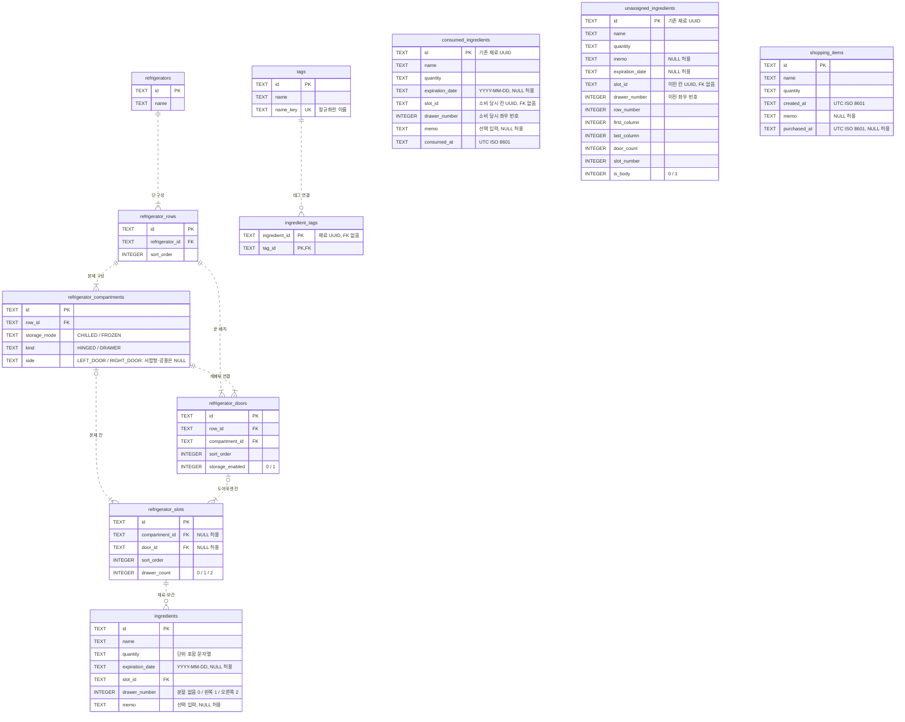

# 냉장고 ERD

칸은 본체와 문 중 하나만 참조하며 도어포켓의 `drawer_count`는 `0`이다. 복합 키와 상세 제약은 [DB 테이블 구조](database-schema.md)를 따른다.

재료는 칸과 좌우 번호를 함께 참조한다. 도면 변경으로 위치가 사라지는 재료는 같은 UUID와 이전 위치 정보를 유지한 채 `unassigned_ingredients`로 옮긴다. 새 위치를 지정하면 `ingredients`로 다시 옮긴다.

소비 완료하면 기존 UUID와 정보를 `consumed_ingredients`로 옮긴다. 완료 기록은 칸을 외래 키로 참조하지 않아 구조 삭제 후에도 남으며, 복구 성공 시 `ingredients`로 다시 옮긴다.

`ingredient_tags.ingredient_id`는 외래 키 없이 세 재료 상태 테이블의 UUID를 참조한다. 상태를 옮길 때 태그 연결을 유지하며, 마지막 재료 기록을 삭제하면 연결도 삭제한다. `shopping_items`는 재료와 독립적으로 저장한다.
